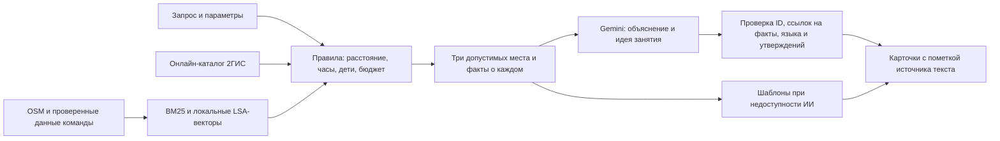

# Серуен — прогулки по Астане

Кейс НИЦ Smart City, Build with AI. Для жителей, родителей, студентов и гостей города: выбрать общественный ориентир, описать желание и получить до трёх мест с объяснением, занятием, временем и источниками.

- [Сайт](https://seruen-astana.netlify.app) — публикует Алихан.
- [API](https://seruen-backend-f36d.onrender.com/docs), [health](https://seruen-backend-f36d.onrender.com/health) — существующий Render Free.
- [Сценарии, ограничения и этика для сдачи](docs/scenarios_and_ethics.md).
- [Аудит первого кейса](docs/spec_audit.md), [передача релиза Алихану и Ерлану](docs/grounded_rag_release.md).
- [Контракт API](docs/api.md), [расширения, редакция 2](docs/feature_expansion_contract.md).

## Что реализовано

1 251 место в локальном снимке и онлайн-поиск 2ГИС. Места можно искать по запросу, времени, составу компании, погоде, расходам и проверенной атмосфере. Есть выбор финиша, маршрут по улицам, остановки по пути, встреча вдвоём, зимний сценарий, достопримечательности с источниками, личные списки и разрешённый офлайн-план. Геймификации и аккаунтов нет.

Карточки содержат «почему», «что делать», время посещения, путь, расписание и источник. Версия фронтенда этого релиза — `seruen-v31-grounded-rag`. Деплой API не публикует файлы Netlify.

## Как работает RAG



1. Сборщик получает OSM через Overpass, нормализует и удаляет дубликаты; Wikipedia и сведения команды обогащают снимок. `python -m pipeline.run` пересобирает кешированные исходники; `--fresh` обращается к внешним источникам. Ключи необязательны.
2. Локальный поиск сочетает BM25 и LSA (TF-IDF → SVD, 64 измерения). Это бесплатный корпусный индекс, не Gemini Embeddings. Онлайн-поиск получает до двух страниц 2ГИС за порцию, затем применяет те же ограничения и ранжирование; остальные места доступны при догрузке. В режиме auto завершённый пустой поиск переключается на локальные варианты с явной пометкой; явный выбор 2ГИС сохраняется.
3. Из текстового индекса исключены сгенерированные описания и предположенные удобства. Подтверждённые запрошенные Wi-Fi, розетки и тишина повышают приоритет. Для 2ГИС используются только явно опубликованные положительные атрибуты; принадлежность к категории не доказывает удобства.
4. Gemini получает три прошедших фильтры места, факты с идентификаторами, запрос и контекст. Он пишет короткое «почему» и действие на RU/KK/EN. Генерация обязана сослаться на существующие факты через `evidence_ids`; результат действительно показывается пользователю.
5. Сервер проверяет ID, язык, длину, ссылки на факты и известные неподтверждённые утверждения. Цены, часы, числовые бюджеты и гарантии не берутся из прозы модели. Неизвестные запрошенные удобства дописывает сервер. Это снижает риск выдумок, но не доказывает истинность любого свободного текста.
6. Ранжирование, выбранный финиш и длительности остаются по правилам. Принятый текст имеет `why_source=ai` и `what_to_do_source=ai`; карточки без принятой генерации — `template`. `mode=ai` означает хотя бы одну карточку с принятым текстом Gemini, а не просто наличие ключа.

## Расстояния и бюджет

- Пешая оценка карточки: `ceil(haversine × 1.3 / speed)`, скорость 75 м/мин; с ребёнком, зимой или при температуре ≤0 — 60.
- Целевой визит: кофе 20, еда 30, парк 20, дети 25, культура 30, смотровая 15, ТРЦ 20, спорт 25, вечернее место 30, необычное 20, библиотека 30, коворкинг 40 минут. Для короткого бюджета: минимум из цели и `max(10, floor(budget/2))`.
- Общий бюджет: путь туда + посещение + выбранный путь после посещения + резерв. `place` — остаться, `return` — вернуться, `destination` — другая точка. Посещение не укорачивается моделью ради включения дальнего места.
- Резерв обычно 5 минут, перед вылетом — 60. Запас на аэропорт условный: реальная дорога и регистрация не рассчитаны.
- Поиск начинается рядом; при отсутствии результатов расширяется один раз ×1,5. Ночью радиус ≤1 км, при сильном холоде/ветре ≤500 м; для кофе/работы путь туда ≤15 минут.
- Базовый балл: 0.4 × текстовое сходство + 0.25 × близость + 0.15 × популярность + 0.1 × статус часов + 0.1 × совпадение подтверждённых тегов. Дополнительно до 0.4 за долю подтверждённых запрошенных удобств, до 0.6 за подтверждённую атмосферу, 0.15 за помещение в сильный холод.
- `/plans/build` и пересчёт используют пешеходный OSRM. При его недоступности возвращается явно помеченная оценка; пунктир не выдаётся за подтверждённую тропу.

## Фото и достоверность

Фото показываются только при наличии проверки конкретного объекта и совпадении SHA-256: `data/photo_identity_review.json`. В этом релизе разрешено 39 привязок к 15 объектам, включая снимки команды и проверенную подборку атмосферы. Общие фотографии Хан Шатыра больше не привязаны к Fame City и другим арендаторам. Поиск поблизости или ответ Gemini сам по себе не устанавливает принадлежность снимка.

`frontend/img/places/index.json` — опубликованная подборка. `scripts/commons_photos.py` теперь пишет только кандидатов в `data/photo_candidates.json`; перед публикацией нужна проверка объекта, источника, автора, лицензии и хеша. Сервер применяет свой список проверок даже к старому индексу Netlify. «Фото пока нет» честнее чужого интерьера. Анализ фото описывает видимое, не доказывает тишину, безопасность, свободные места или доступность маршрута.

## Запуск и проверки

Python 3.12+, Node 22+. Из корня:

```bash
make setup
make index
make run
# Отдельно:
npm ci
npm test
.venv/bin/python -m pytest -q
POI_PATH=data/poi.json DATA_KIND=real .venv/bin/python eval/run.py --output eval/real
.venv/bin/python eval/run_spec.py
```

Без ключа работает `no_ai`. Настройки — `.env.example`; локальный `.env` не создаётся и не нужен для Render. Секреты остаются в Environment сервиса. Платные поля Google Places выключены; 2ГИС работает в существующей конфигурации. Новых ресурсов или подписок релиз не создаёт. При исчерпании внешних квот бесплатный режим не гарантирует постоянный ИИ: есть ограничение вызовов, кеш и честный резервный ответ.

Последняя локальная проверка: 472 Python-теста; результаты фронтенда и живого деплоя — [в передаче релиза](docs/grounded_rag_release.md). Оба набора по 30 запросов проходят: [исходные фикстуры](eval/real/report.md), [сценарии Ерлана](eval/real_spec/report.json). Автотесты проверяют структуру и ограничения; пользовательские оценки полезности не выдумывались и пока не собраны.

Для локального просмотра фронтенда: `python3 -m http.server 5173 --directory frontend`. Сайт по умолчанию использует публичный API. Алихан публикует весь `frontend/` из `main`, включая фотографии, `sw.js` и страницу приватности.

## Данные, ограничения и приватность

В снимке 1 251 место, 270 записей с часами OSM, 22 описания Wikipedia и 1 229 описаний с пометкой `generated`. Отсутствие часов или рейтинга допустимо по ТЗ; неизвестное не заполняется догадкой. Подробности: [данные](docs/data.md), [отчёт сборщика](data/quality_report.md).

Координаты округляются до трёх знаков (~100 м), что не является анонимизацией. Заметки и сохранённые прогулки остаются на устройстве. Gemini получает текст запроса и факты кандидатов, без отдельных полей координат пользователя, финиша и истории; личные данные, введённые в текст вручную, автоматически не удаляются. 2ГИС получает округлённый центр, OSRM — точки пути; внешние поставщики могут журналировать запросы и IP. Логи приложения содержат только режим, длительность, число кандидатов и код ошибки. Подробнее: [страница приватности](frontend/about.html).

Ограничения: неполные и устаревающие сведения, эвристический разбор языка, приблизительные пешие времена, квоты бесплатных API, отсутствие гарантии проходимости/безопасности и отдельного нагрузочного аудита. Исторические отчёты 17–18 октября не являются статусом текущей квоты. Презентация и YouTube-демо готовятся командой отдельно.
