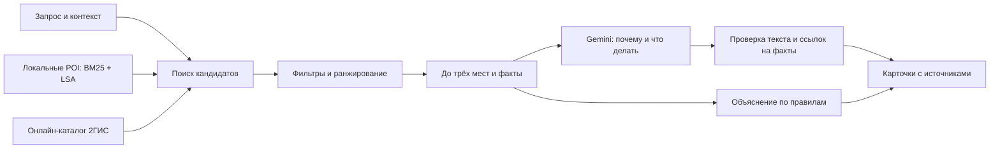

# Серуен · прогулки по Астане

**Куда сходить рядом, что там сделать и успею ли я?** Серуен помогает выбрать место с учётом времени, погоды, компании и условий посещения, затем построить прогулку к выбранной цели.

Проект для **кейса 1 НИЦ Smart City** на хакатоне **Build with AI**. Для жителей, родителей, студентов, удалёнщиков и гостей Астаны.

**[Открыть сайт](https://seruen-astana.netlify.app)** · **[API и примеры](https://seruen-backend-f36d.onrender.com/docs)** · **[Состояние сервера](https://seruen-backend-f36d.onrender.com/health)** · **[Сценарии и ограничения PDF](docs/submission/Seruen_test_scenarios_and_limits.pdf)**

## Навигация

[Быстрый старт](#попробовать-за-минуту) · [Возможности](#возможности-и-их-границы) · [RAG](#как-работает-rag) · [Правила](#правила-рекомендаций) · [Данные](#данные-и-источники) · [ТЗ](#соответствие-тз) · [Локальный запуск](#запуск-у-себя) · [API и настройки](#api-и-настройки) · [Проверки](#проверки-и-состояние-выпуска) · [Приватность](#приватность-и-безопасность) · [Публикация](#публикация-и-работа-команды) · [Решение проблем](#если-что-то-не-работает)

## Попробовать за минуту

1. Откройте сайт и проверьте старт. Можно разрешить геолокацию, выбрать ориентир или поставить точку на карте.
2. Напишите желание: **«Я с ребёнком. На улице холодно. Есть час. Куда пойти?»**
3. В контексте задайте время, компанию, погоду и финиш: **остаться у выбранного места**, **вернуться в начало** или **прийти в другую точку**.
4. Сравните до трёх рекомендаций. В карточке есть «почему», занятие, время, источник и неизвестные условия. Другие загруженные места доступны в списке и на карте.
5. Выберите конкретное место и начните прогулку. Если замёрзли или устали, запросите остановку по пути; основная цель сохраняется.

**Топ-3 — альтернативы для выбора, а не обещание посетить все три за указанный срок.** Составной маршрут строится отдельно и повторно проверяется по времени.

### Идеи для прогулки

| Сценарий | Пример запроса | Что проверяем |
|---|---|---|
| S1 · Кофе и работа | «Нужны кофе и розетка для ноутбука» | Категория, близость, подтверждённые удобства; неизвестные розетки и тишина не выдумываются |
| S2 · С ребёнком | «Я с ребёнком, есть час. Куда рядом?» | Пригодность для детей; при холоде или дожде — помещения |
| S3 · Короткая прогулка | «Я возле Mega Silk Way, хочу прогуляться 30–60 минут» | Время на путь, посещение и выбранный финиш |
| S4 · Необычное у EXPO | «Хочу что-то необычное на 1–2 часа, пешком» | Культурный досуг; в плохую погоду помещения вместо уличных объектов |
| S5 · Перед вылетом | «У меня два часа перед вылетом» | Близкие места и резерв; без обещания успеть на рейс |
| S6 · Ночная прогулка | «Что необычного рядом ночью?» | Расписание, короткие переходы, предупреждение и ограничения для детей |

Демо использует общественные ориентиры. Смоделированные время и погода отмечаются в интерфейсе. Входы: [шесть сценариев](frontend/scenarios.json), [30 формулировок Ерлана](eval/scenarios_spec.json).

## Возможности и их границы

| Возможность | Что умеет сервис | Ограничение |
|---|---|---|
| Поиск рядом | Локальная база и 2ГИС; название, категория, предпочтения; догрузка мест | Не гарантирует полный список заведений города. Топ-3 и число результатов каталога — разные показатели |
| Объяснения Gemini | «Почему» и «что делать» по фактам допустимых кандидатов, включая 2ГИС | При квоте, отказе или отклонении текста — явно обозначенный ответ по правилам |
| Контекст | Время, погода, ребёнок, расходы, ограничения ходьбы, исключённые места и категории | Разбор текста основан на правилах; неоднозначные запросы могут пониматься неточно |
| Цель и финиш | Маршрут к отмеченному месту; остаться там, вернуться или выбрать другой финиш | Старый API-клиент без `finish_mode` сохраняет прежний режим возврата |
| Остановки по пути | «Замёрзли» / «Устали», места согреться и лавочки; принятая остановка перестраивает путь | Только подходящие варианты впереди по пути и в бюджете. Ошибка не стирает прогулку |
| Изменение планов | Пересчёт оставшегося времени, пропуск/замена остановки, возврат к предыдущему успешному состоянию | Для новой позиции нужно обновить точку; непрерывного слежения нет |
| Почему не подходит | Причины исключения, «слишком далеко», «уже был», смена места или типа | Закрытые места могут оставаться справочно с пометкой непригодности, но не как рекомендация |
| Удобства | Проверенные туалеты, лавочки, тёплые входы и другие точки | Небольшое покрытие; кафе не означает свободный туалет, парк не доказывает наличие лавочки |
| Условия расходов | `free`, `optional_purchase`, `paid`, `unknown`; строгие бесплатные фильтры | Нет полного актуального прайса. Средний чек не равен цене входа |
| Встреча вдвоём | Старт A и B, до трёх мест с оценками пути для обоих, выбор заведения и маршрут от A | B — выбранный старт, не геолокация второго человека. Подбор только среди рассмотренных кандидатов |
| Зимняя Астана | Помещения и ограничение каждого уличного перехода | Не подтверждает состояние льда, отопление, защищённость от ветра или наличие мест |
| Достопримечательности | 26 объектов, краткие сведения, источники и «Узнать больше» | Википедия — при подходящей статье, иначе официальный источник; не для каждого POI |
| Фото и анализ | Проверенные фото; Gemini описывает видимые свет, пространство, сидения и детскую зону | Не доказывает тишину, безопасность, розетки, цены или текущую загруженность |
| Мои места | «Хочу сходить», «был», избранное, личные заметки | Только этот браузер; нет аккаунтов и синхронизации |
| Сохранённая прогулка | Экспорт разрешённых данных, открытие плана и перепроверка онлайн | Не включает полную офлайн-карту, свежие часы и весь каталог 2ГИС |
| Карта и оформление | Схема, спутник, гибрид; две темы, дневное/ночное фото, ширина панели, полноэкранная карта | Спутник имеет ограниченную детализацию. Смена оформления не меняет цель |
| RU / KK / EN | Интерфейс и объяснения на трёх языках | Казахские формулировки требуют вычитки носителем |

**Подбор «По атмосфере» удалён полностью.** Анализ фотографий конкретного места остался. Сундуков, монет, наград, аккаунтов и серверной истории перемещений нет.

## Как работает RAG

**Код решает, ИИ объясняет.** Сначала система находит и проверяет места, затем Gemini получает факты для объяснения. Модель не меняет координаты, порядок рекомендаций, выбранную цель или рассчитанное время.



1. **Сбор.** OSM через Overpass → нормализация и дедупликация → Wikipedia и проверенные дополнения команды → индекс.
2. **Поиск.** BM25 сопоставляет текст; LSA использует локальные векторы TF-IDF/SVD, без платного сервиса эмбеддингов. Если индекс недоступен, остаётся BM25.
3. **Фильтрация.** Общие ограничения применяются до генерации. Сгенерированные описания и предположенные удобства не считаются фактическим доказательством.
4. **Объяснение.** Gemini получает запрос, контекст и допустимые места. Текст должен ссылаться на существующие факты через `evidence_ids`.
5. **Контроль.** Проверяются ID, язык, длина и известные неподтверждённые утверждения. Отклонённая карточка получает шаблон. Цены, часы и расчёты не берутся из свободного текста модели.

| Поле ответа | Значение |
|---|---|
| `source=local / 2gis` | Откуда получены места |
| `why_source`, `what_to_do_source` | `ai` — принятый текст Gemini; `template` — объяснение по правилам |
| `selection_source=rules` | Места и их порядок выбраны алгоритмом |
| `mode=ai` | Хотя бы одна карточка содержит принятую генерацию |
| `mode=no_ai` | Ответ без принятой генерации |
| `mode=cached` | Повторно использован ответ; происхождение текста сохраняется в карточках |

`/health.mode_available` сообщает о конфигурации. Наличие `ai` **не подтверждает** успешный вызов Gemini или доступную квоту.

## Правила рекомендаций

- **Холод и дождь.** Просьба укрыться учитывается даже без прогноза. При температуре ≤ −15 °C или ≥ +35 °C, ветре ≥ 10 м/с либо осадках ≥ 2 мм включаются помещения и радиус до 500 м. Явное желание гулять на улице и зимний режим имеют отдельные правила. «Не холодно» и «холодный кофе» не включают укрытие.
- **Дети.** Исключаются взрослые места и неподтверждённая пригодность для детей. «Кофе с ребёнком» сохраняет категорию кофе. Название «Детская площадка» само по себе не определяет улицу или помещение: учитываются данные объекта.
- **Время.** При конфликте текста и настроек применяется меньший лимит. «Осталось 20 минут» обновляет исходное ограничение. Проверяется путь, посещение, финиш и резерв.
- **Часы.** Проверяется весь интервал визита, включая перерывы и полночь. Неизвестные часы остаются неизвестными; расписание не доказывает фактическую доступность.
- **Расходы.** `free_only` требует проверенной бесплатности, `no_required_purchase` допускает необязательную покупку. Запрос «до 2000 ₸» сейчас консервативно отбирает бесплатные посещения, а не сравнивает платные предложения.
- **Ночь и доступность.** Ночью сокращается радиус и добавляется предупреждение. Фильтр доступности требует `wheelchair=yes`, но не подтверждает весь путь.
- **Нет подходящего места.** Возвращается объяснение. В `auto` возможен локальный резерв с пометкой источника; явный `source=2gis` не подменяется. Обязательные ограничения ради заполнения карточек не ослабляются.

<details>
<summary><strong>Формулы времени, ранжирование и остановки</strong></summary>

```text
путь в минутах = ceil(расстояние по прямой × 1.3 / скорость)
общий бюджет = путь туда + посещение + путь к финишу + резерв
```

Скорость — 75 м/мин; с ребёнком, в зимние месяцы, при температуре ≤ 0 °C или зимнем режиме — 60 м/мин. Резерв обычно 5 минут, перед вылетом — до 60 минут из заданного лимита. Это не расчёт трансфера и регистрации.

Ориентиры посещения: кофе 20, еда 30, парк 20, дети 25, культура 30, смотровая 15, ТРЦ 20, спорт 25, вечернее место 30, необычное 20, библиотека 30, коворкинг 40 минут. Для короткого бюджета: `min(ориентир, max(10, floor(бюджет / 2)))`.

**«Два часа» — максимум всей прогулки, не два часа работы в кафе.** Длительность фильма или спектакля отдельно не подтверждена. Модель не сокращает визит ради далёкого места.

Локальный базовый балл:

```text
0.40 × релевантность + 0.25 × близость + 0.15 × популярность
+ 0.10 × статус часов + 0.10 × совпадение подтверждённых тегов
```

Дополнительные прибавки учитывают подтверждённые запрошенные удобства и помещение в тяжёлую погоду. Жёсткие ограничения важнее балла. Радиус при пустом поиске может расширяться один раз ×1,5 с сохранением пределов: ночью до 1 км, при тяжёлой погоде до 500 м; для кофе/работы путь туда ограничен 15 минутами.

Прогулка использует пешеходный OSRM. Для принятой остановки проверяются уличный путь через неё, прежние цели и добавочное время. При отказе маршрутизатора добавление не заменяет существующий уличный путь приблизительной линией: текущая прогулка сохраняется. В других допускающих это режимах оценочная линия явно помечается.

Остановка предварительно ищется впереди до следующей цели: до 450 м от текущей точки, до 100 м от прямого коридора, с ограничением добавочного пути и последующей проверкой маршрута. Такой отбор может пропускать варианты при сложной геометрии улиц.

Подробности: [условия подбора](docs/scenario_constraints_audit.md), [остановки](docs/walk_first_ux.md), [расчёты](backend/geo.py).

</details>

## Данные и источники

Состояние набора и готовности на **20 октября 2026 года**:

| Набор | Объём | Ограничение |
|---|---:|---|
| Локальные POI | 1 251 место, 12 категорий | OSM-снимок от 17.10.2026, не полный реестр города |
| Часы в снимке | 270 записей | Отсутствие расписания не заменяется «открыто» |
| Описания | 22 Wikipedia; 1 229 `generated` | Сгенерированный текст не является подтверждённым фактом RAG |
| Удобства | 16 записей; 15 готовы | Основное проверенное покрытие: EXPO и Нуржол / Бәйтерек — Хан Шатыр |
| Условия посещения | 24 записи; 13 готовы | Неизвестные условия не становятся бесплатными |
| Достопримечательности | 26 объектов | Отдельный каталог, не статьи для всех POI |
| Офлайн-экспорт | 15 допустимых точек | Только разрешённые актуальные записи; возможен частичный экспорт |
| Проверка фотографий | 39 привязок к 15 объектам | Количество файлов галереи не равно числу одобренных фотографий |

Готовность дополнений: [`/features/status`](https://seruen-backend-f36d.onrender.com/features/status). Проверки удобств/условий устаревают через 30 дней, собственных мест — через 90; нужна повторная проверка.

| Источник | Для чего используется | При недоступности |
|---|---|---|
| OSM / Overpass | Места, координаты, категории, доступные атрибуты | Остаётся собранный снимок |
| 2ГИС | Поиск, филиалы, адреса, опубликованные часы, рейтинг при наличии | Ошибка объясняется; в `auto` возможен локальный резерв. Рейтинг не подменяется нулём |
| Wikipedia / официальные сайты | Достопримечательности и «Узнать больше» | Без подходящего источника история не выдумывается |
| Gemini | Объяснения и анализ фото | Ответ по правилам; проверенные фото могут остаться без нового анализа |
| Open-Meteo | Городская погода в контексте запроса | Погода не придумывается; текст запроса продолжает учитываться |
| Пеший OSRM | Уличная геометрия | Помеченная оценка или отказ пересчёта с сохранением прежнего пути |
| Google Places | Необязательный адаптер деталей | Детали сейчас выключены; карта OSM и ссылки Google Maps не требуют Google-ключа |

Фото берутся из проверенной подборки команды и разрешённых снимков Commons. Интеграция 2ГИС **не предоставляет фотографии**. Реестр связывает место и файл через SHA-256; фото ТРЦ не считается фото любого арендатора.

### Пересборка

После установки зависимостей, из корня:

```bash
python -m pipeline.run
python scripts/validate_feature_data.py
python scripts/reindex.py
```

Первая команда **перезаписывает** снимок POI и отчёт. Используются сохранённые исходники, если они есть. При доступном ключе этап описаний может обращаться к Gemini; для полностью локальной пересборки нужны сохранённые исходники и окружение без ключей.

`python -m pipeline.run --fresh` обращается к внешним источникам и расходует их квоты. Для обычного старта это не требуется. Форматы: [POI](docs/data.md), [дополнения Ерлана](docs/feature_data_handoff.md), [источники и полевые проверки](docs/feature_expansion_data.md), [реестр фото](data/photo_identity_review.json).

## Соответствие ТЗ

Основание — **первый кейс НИЦ Smart City**, «FINAL Задачи_хакатона.docx.pdf», страницы 1–3. Требования MCP / Vertex AI / GCP относятся ко второму кейсу CampusPulse.

| Пункт ТЗ | Где реализовано | Статус и граница |
|---|---|---|
| Концепция, аудитория, сценарии | Введение и сценарии выше | Описано |
| Интерактивное демо | Сайт, карта, контекст, карточки, прогулка | Опубликовано; доступность API зависит от квот |
| Автоматизированный сбор данных | `pipeline/`, снимок, отчёт качества, индекс | Реализовано; сведения устаревают |
| Название, координаты, описание, категории | `data/poi.json`, схемы | Представлены с происхождением описания |
| Часы, контакты, рейтинг при наличии | POI и онлайн-детали 2ГИС | Пробелы остаются неизвестными |
| Поиск по POI и генерация RAG | BM25 + LSA / 2ГИС → правила → Gemini → проверка | Реализовано; последний сценарный прогон прошёл без живой генерации |
| 1–3 места, почему, время, действие | Карточки рекомендаций | При наличии допустимых кандидатов; пустая выдача объясняется |
| Локация, время и контекст | Бюджет, часы, дети, погода, расходы, финиш | Проверено тестами; не гарантия точности на местности |
| Документ сценариев и ограничений | [PDF](docs/submission/Seruen_test_scenarios_and_limits.pdf) / [Word](docs/submission/Seruen_test_scenarios_and_limits.docx) | Подготовлен; датированный снимок проверки |
| Этика и privacy | Раздел ниже, [страница о данных](frontend/about.html) | Описаны передача данных, неопределённость и безопасность |
| Репозиторий / архив | Этот репозиторий | Перед сдачей обеспечить жюри доступ |
| Презентация 5–7 минут | Отдельный материал команды | Готовый материал здесь не подтверждён |
| YouTube-демо | Отдельный материал команды | Публичная ссылка здесь пока не указана |

**Дополнительные цели:** RU / KK / EN реализованы. Составной план поддерживается, но три посещения не гарантируются при любом бюджете. Встреча вдвоём есть; полноценный подбор для группы из 3–5 человек не заявлен. Фильтр доступности есть, весь безбарьерный путь не подтверждён. Актуальная лента событий не реализована.

Автотесты не являются оценкой жюри или доказательством готовности к промышленной эксплуатации.

## Запуск у себя

Нужны **Python 3.12+** и **Node.js 22+**. Node нужен для тестов интерфейса; сайт работает без обязательной сборки.

### Бэкенд

```bash
git clone https://github.com/utepbergenoff/seruen.git
cd seruen
python3 -m venv .venv
source .venv/bin/activate
python -m pip install -r requirements-dev.txt
npm ci
python scripts/reindex.py
python -m scripts.serve
```

Открыть [локальный Swagger](http://127.0.0.1:8000/docs) и [health](http://127.0.0.1:8000/health).

<details>
<summary>Windows PowerShell</summary>

```powershell
git clone https://github.com/utepbergenoff/seruen.git
cd seruen
py -3.12 -m venv .venv
.\.venv\Scripts\python.exe -m pip install -r requirements-dev.txt
npm ci
.\.venv\Scripts\python.exe scripts/reindex.py
.\.venv\Scripts\python.exe -m scripts.serve
```

Активация не обязательна: остальные Python-команды выполняйте через `.\.venv\Scripts\python.exe`. `tzdata` включён в зависимости, данные читаются в UTF-8.

</details>

Без ключей работают локальный поиск и `no_ai`. **Создавать `.env` необязательно.** Если файл уже есть, код может его прочитать; не публикуйте его и ключи в Git.

### Фронтенд

Во втором терминале из корня:

```bash
python3 -m http.server 5173 --directory frontend
```

Открыть [http://localhost:5173](http://localhost:5173). Порт 5173 разрешён в стандартном CORS. **Локальный сайт по умолчанию обращается к опубликованному Render API.**

Для проверки локального бэкенда временно установить в `frontend/config.js`:

```js
API_URL: "http://127.0.0.1:8000",
```

Оба сервера должны работать. Перед публикацией вернуть `https://seruen-backend-f36d.onrender.com`. Скрипт `scripts/set_api_url.py` принимает HTTPS-адрес публикации; пустой адрес подходит только для настроенного общего сервера / прокси.

Ключи не требуются для локального режима. Карта, погода, онлайн-маршрут и фото с сайта всё равно требуют сети.

## API и настройки

Адрес: `https://seruen-backend-f36d.onrender.com`. JSON/UTF-8; расстояния — метры, длительности — минуты, время — `Asia/Almaty`.

Схемы: [Swagger](https://seruen-backend-f36d.onrender.com/docs), [`schemas.py`](backend/schemas.py), [`plan_models.py`](backend/plan_models.py). Пояснения: [API](docs/api.md), [расширения](docs/feature_expansion_contract.md).

| Методы | Назначение |
|---|---|
| `GET /health`, `GET /features/status` | Конфигурация, флаги и готовность данных |
| `GET /scenarios` | Шесть демо-запросов |
| `POST /recommend` | Рекомендации; источник `auto`, `local`, `2gis` |
| `POST /candidates` | Кандидаты и причины исключения; для диагностики без генерации выбрать `source=local` |
| `POST /plans/build`, `/plans/recalculate`, `/plans/winter` | Построение, пересчёт, зимние ограничения |
| `POST /comfort/search`, `/meet/search` | Удобства и встреча вдвоём |
| `GET /city/stories`, `POST /city/history` | Достопримечательности и ближайшие объекты |
| `POST /plans/export`, `/plans/refresh` | Офлайн-экспорт и перепроверка |
| `POST /places/identities` | Проверенные связи ID одного места |
| `GET /places/{poi_id}/2gis`, `/places/{poi_id}/details` | Детали 2ГИС / необязательные Google Places |
| `POST /places/{poi_id}/photos` | Проверенные фото и доступный анализ |

<details>
<summary><strong>Пример запроса с ребёнком и холодом</strong></summary>

В Swagger: `POST /recommend` → Try it out. `source=local` исключает зависимость от каталога 2ГИС, но не отключает настроенный Gemini.

```json
{
  "location": {"lat": 51.133, "lon": 71.404, "precision_m": 100, "source": "preset"},
  "query": "Я с ребёнком. На улице холодно. Есть час. Куда пойти?",
  "source": "local",
  "finish_mode": "place",
  "context": {
    "time_budget_min": 60,
    "companions": "child",
    "lang": "ru",
    "now": "2026-10-20T14:00:00+05:00",
    "simulate": true,
    "weather": {"temp_c": -16, "wind_ms": 5, "precip_mm": 0}
  }
}
```

Проверить `considered`, `recommendations`, `notes`, `safety`, источники текста и `budget_breakdown`. Если подтверждённого помещения нет, допустим пустой результат. Для текущего времени убрать `now` и установить `simulate=false`.

</details>

### Переменные окружения

| Переменная | Назначение |
|---|---|
| `POI_PATH=data/poi.json`, `DATA_KIND=real` | Реальный снимок; `poi_sample.json` / `sample` — отдельные тестовые данные |
| `GEMINI_API_KEY`, `GEMINI_MODEL` | Необязательная генерация; модель по умолчанию указана в `.env.example` |
| `TWOGIS_API_KEY`, `TWOGIS_ENABLED=true` | 2ГИС при действующем доступе |
| `TWOGIS_SEARCH_ENABLED=true` | Каталожный поиск |
| `TWOGIS_REQUESTS_PER_MINUTE=20`, `TWOGIS_REQUESTS_PER_DAY=200` | Локальные лимиты поиска и деталей на процесс |
| `GOOGLE_PLACES_ENABLED=false` | Детали Google выключены по умолчанию; один ключ их не включает |
| `PHOTOS_ENABLED=true`, `PHOTO_INDEX_URL` | Фото и адрес опубликованного индекса |
| `FEATURE_DATA_DIR=data`, `ROUTING_ENABLED=true` | Дополнения и пешая маршрутизация |
| `AIRPORT_RESERVE_MIN=60` | Условный резерв перед вылетом |
| `CORS_ORIGINS` | Разрешённые адреса сайта через запятую |
| `HOST`, `PORT` | Интерфейс/порт; на Render `HOST=0.0.0.0`, порт задаёт платформа |
| `MOCK_MODE=false`, `WARM_CACHE=true` | Обычный режим и прогрев без вызова ИИ |

Полный набор: [`.env.example`](.env.example), [`Settings.from_env`](backend/config.py). Ключи — только на сервере / в Environment хостинга, не во фронтенде.

**Расходы:** используется существующий Render Free; для локального режима новые платные сервисы не нужны. Бесплатность API зависит от аккаунта, лицензии и квоты. Локальные счётчики сбрасываются при перезапуске и **не ограничивают списания у провайдера**. Код приложения не переключает тарифы: при отказе API используется доступный резервный режим. Настройки оплаты проверяются отдельно в аккаунте провайдера.

## Проверки и состояние выпуска

**Срез 20.10.2026, код бэкенда `cde5998b91f4`.** Старые отчёты описывают свои даты и не являются текущим статусом квот.

| Проверка | Результат | Граница |
|---|---|---|
| Python | 624 теста пройдены; одно предупреждение тестовой библиотеки | Не проверка всех мест и живых провайдеров |
| JavaScript | 144 теста пройдены | Не все устройства и браузеры |
| Матрица ограничений | S1–S6 × обычный запрос / дождь / ребёнок / 15 минут / бесплатно | Не независимая оценка полезности |
| Живое API | 12 запросов; проверки ограничений пройдены | Часть ответов пустая, результат не гарантирован в каждом случае |
| Генерация в этом прогоне | Все 12 ответов `no_ai` | Живой Gemini этим прогоном не подтверждён |
| 2ГИС | В контрольном прогоне отвечал; `/health` сообщает `last_status=ok` | Не гарантия дальнейшей доступности |
| Сайт | HTTP-проверка: `seruen-v43-tomi-merge`, «Идеи для прогулки» опубликованы | Полного нового браузерного прогона после этой публикации не было |

В S3 локальный резерв дал NU Park и сквер в пределах времени. В S4 при сильном ветре в радиусе 500 м проверенных помещений не оказалось даже после переключения каталожного запроса на музеи. Это границы покрытия; уличные места не подставлены.

Подготовленный интерфейс проверялся на RU/KK/EN, в двух темах, при ширинах 320/390 px и десктопе 1280 px. Массового нагрузочного аудита, полевого обхода всех маршрутов и независимых пользовательских оценок нет.

### Повторить проверки

Из корня, в активированном Python-окружении:

```bash
npm ci
npm test
python -m pytest -q
python -m ruff check backend tests scripts pipeline eval
python scripts/validate_feature_data.py
python eval/run.py --output eval/local-check
python eval/run_spec.py
```

`npm ci` нужен и для полного Python-набора: один тест запускает JS → FastAPI. Автотесты используют изолированные данные и имитации внешних ответов, без новых платных вызовов.

Оценочные скрипты без `--ai` проверяют локальные сценарии. Они записывают отчёты; `run_spec.py` обновляет `eval/real_spec/`. Это не оценка живого ИИ. Синтетические места не публикуются как реальные.

[Документ PDF](docs/submission/Seruen_test_scenarios_and_limits.pdf) и [Word](docs/submission/Seruen_test_scenarios_and_limits.docx) фиксируют момент контрольного прогона; более поздняя публикация сайта отмечена выше. [Правила последней проверки](docs/scenario_constraints_audit.md).

## Приватность и безопасность

- Координаты округляются до трёх знаков на клиенте и сервере. Можно выбрать ориентир вместо GPS. Это уменьшает точность, **но не анонимизирует местоположение**.
- Нет аккаунтов и постоянной серверной истории. Заметки и планы остаются в браузере; очистка данных сайта их удаляет. Синхронизации и автоматической резервной копии нет.
- Gemini получает запрос, контекст и факты кандидатов без отдельных полей координат пользователя, финиша и истории ID. Личные сведения в самом тексте автоматически не удаляются.
- 2ГИС получает округлённый центр, OSRM — точки пути. Поставщики карт, погоды и хостинг могут получать IP и вести собственные журналы.
- Лог приложения содержит режим, длительность, число кандидатов и код ошибки, без текста и координат. Ответы API имеют `Cache-Control: no-store`.
- Ограниченные кеши в памяти: обычные ответы до 30 минут, каталог до 5 минут, успешный анализ фото до 6 часов. Истёкшие записи могут оставаться до вытеснения/перезапуска.
- Закладка 2ГИС хранит название, категорию и адрес только в браузере. Координаты и полный ответ каталога не копируются в постоянную базу / офлайн-план без разрешённых прав.
- Источники, неизвестные сведения и идеи ИИ различаются. Фото, рейтинг и расписание не гарантируют безопасность, доступность или качество места.

Погодные пороги — настройки подбора, не медицинские нормы. Маршрут не подтверждает состояние льда, переходов и входов. Приложение не заменяет проверку обстановки и расписания на месте.

Спутник EOX/Sentinel-2 имеет ограниченную детализацию и некоммерческие условия текущего слоя; атрибуция видна на карте. Для коммерческого запуска нужна отдельная проверка прав на карты, фото, данные и условий API. Свободное коммерческое использование всех материалов не заявляется.

Подробнее: [О данных и приватности](frontend/about.html), [права и проверка дополнений](docs/feature_expansion_data.md).

## Публикация и работа команды

| Участник | Область |
|---|---|
| Томирис | Бэкенд, RAG, правила, интеграции, Render |
| Алихан | Интерфейс, карта, UX, публикация Netlify |
| Ерлан | Сбор и проверка данных, условия, удобства, источники и фото |

Процесс: **`feat/*` → PR → проверка → `main` → публикация нужной части**. При объединении сохраняются более поздние изменения коллег.

**Render.** Конфигурация — [`render.yaml`](render.yaml). Сборка: установка `requirements.txt` и `scripts/reindex.py`; запуск: `python -m scripts.serve`; health check: `/health`. После мержа проверить ветку/коммит → **Manual Deploy → Deploy latest commit** → дождаться **Live** → проверить health, готовность данных, CORS и контрольный запрос. В Blueprint автодеплой выключен.

**Netlify.** Алихан публикует **всю согласованную папку `frontend/`**, включая фото, `config.js`, `about.html`, стили и `sw.js`. Если на сайте более свежая ветка Алихана, сначала объединить её с `main`. Не заменять её старой папкой.

После публикации проверить второе/третье выбранное место, финиш, остановку по пути, возврат к списку, A/B встречи, часы, темы и мобильный экран. Ключи в сайт не добавляются.

**Мерж, деплой Render и публикация Netlify — отдельные действия.** Изменение документации не требует перезапуска бэкенда.

## Если что-то не работает

| Симптом | Что проверить |
|---|---|
| ИИ недоступен | Источник текста карточек, квоту и модель. Ключ в health недостаточен; новый ключ того же проекта не гарантирует новую квоту |
| Нет мест/рейтингов 2ГИС | `source_error`, `last_status`, доступ ключа и квоту. У конкретного филиала рейтинг может отсутствовать |
| Мало мест | Радиус, время, фильтры, `next_cursor`. Догрузка не отменяет обязательные условия |
| На холоде пусто | Наличие подтверждённых помещений в радиусе. Уличные площадки не должны подменять укрытие |
| Долго определяется геолокация | Разрешения ОС/браузера/сайта и точность. Можно сразу выбрать точку вручную |
| Нет фото/анализа | Проверенную привязку файла к объекту, индекс сайта, квоту Gemini |
| Путь приблизительный | Доступность пешего маршрутизатора и источник линии. Ошибка остановки должна сохранить прежний путь |
| Старый интерфейс | Полноту публикации frontend и кеш service worker; обновление API сайт не меняет |
| Локальный сайт обращается не туда | `frontend/config.js`, оба локальных сервера, CORS origin |

## Структура проекта и документация

```text
backend/          API, RAG, правила, планы и интеграции
frontend/         HTML, CSS, JavaScript, Leaflet, PWA и изображения
pipeline/         сбор, нормализация и обогащение данных
data/             POI, исходники, индекс и проверенные дополнения
scripts/          переиндексация, валидация, запуск и утилиты
tests/            серверные тесты и tests/frontend/ для интерфейса
eval/             сценарии и датированные отчёты
docs/             контракты, инструкции, источники, отчёты выпусков
docs/submission/  документ сценариев и ограничений для сдачи
```

| Материал | Для чего |
|---|---|
| [API](docs/api.md), [расширения](docs/feature_expansion_contract.md) | Запросы, ответы, совместимость |
| [Интерфейс](docs/frontend/README.md) | Просмотр, файлы, публикация |
| [2ГИС](docs/twogis.md), [фото](docs/photos.md) | Интеграции и проверка данных |
| [POI](docs/data.md), [качество](data/quality_report.md) | Состав и происхождение снимка |
| [Форматы для Ерлана](docs/feature_data_handoff.md) | Добавление удобств, условий и связей ID |
| [Условия рекомендаций](docs/scenario_constraints_audit.md) | Погода, дети, время, часы, расходы |
| [Планирование](docs/walk_first_ux.md) | Цель, финиш, остановки |
| [Сценарии и этика от 19 октября](docs/scenarios_and_ethics.md), [аудит ТЗ от 19 октября](docs/spec_audit.md) | Исторические свидетельства; текущий состав и статус — в этом README |

Следующие шаги для реального запуска: расширить проверенные входы и удобства, собрать оценки полезности, проверить доступность и нагрузку, вычитать переводы, согласовать права и устойчивые квоты внешних сервисов.
