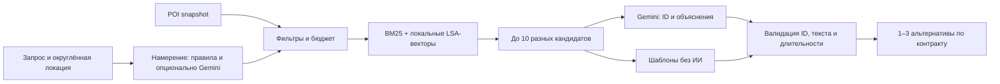

# Серуен — бэкенд советчика по прогулкам в Астане

Расширение без геймификации: серверный маршрут и пересчёт, обратная связь, удобства, условия расходов, разрешённый офлайн-план, атмосфера фото и персональные исключения. [Контракт для Алихана](docs/feature_expansion_contract.md), [форматы для Ерлана](docs/feature_data_handoff.md), [серверная приёмка и оставшиеся зависимости](docs/feature_expansion_acceptance.md). Новые коллекции пока пусты; завершение нового интерфейса и реальных подборок требует работы команды. Старые запросы совместимы.

Кейс НИЦ Smart City, Build with AI. Код проверяет места, расстояния, ограничения и бюджет; Gemini, если настроен, выбирает только допустимые ID и пишет короткие объяснения.

**Текущая версия: 1 251 локальное реальное место и живой поиск 2ГИС, Render Free.** Gemini настроен, но при проверке 18.10 в 22:40 (Астана) возвращал HTTP 429; ответы честно помечены без ИИ. Ключ Google Places проверен; рейтинги и часы выключены до проверки облачной квоты владельцем. [Подключение API](docs/api_integrations.md). Гибридный поиск BM25 + LSA пересобран на реальных данных. Источники и ограничения: [данные](docs/data.md), [интеграция и проверки](docs/real_data_integration.md).

- API и примеры: [docs/api.md](docs/api.md), [request.json](docs/request.json), [response.json](docs/response.json).
- Статус каждого B1–B12 и FR: [docs/checklist.md](docs/checklist.md).
- Измеренный прогон: [eval/real/report.md](eval/real/report.md); 30 сценариев Ерлана: [eval/real_spec/report.json](eval/real_spec/report.json).
- Размещение и передача команде: [docs/handoff.md](docs/handoff.md).
- Публичный API на Render Free: [Swagger /docs](https://seruen-backend-f36d.onrender.com/docs), [health](https://seruen-backend-f36d.onrender.com/health). Базовый адрес для фронта: `https://seruen-backend-f36d.onrender.com`.
- Публичная проверка реальных данных 18.10: [отчёт](docs/real_data_deployment_verification.json) — 1 251 место, 6/6 демо, 30/30 сценариев Ерлана, ночь и CORS; S1 проверен на сайте.
- Исторический публичный прогон на сэмпле: [docs/deployment_verification.json](docs/deployment_verification.json) — 6/6 демо, 30/30 фикстур, кеш и CORS проверены 17.10.2026.
- Сайт команды: [seruen-astana.netlify.app](https://seruen-astana.netlify.app). CORS для сайта настроен и проверен: [docs/cors_verification.json](docs/cors_verification.json). В браузере проверен S1 с тремя карточками и метками; видео ещё не предоставлено.

## Для кого

Для жителей и гостей Астаны, у которых есть 15–180 минут: кофе и работа рядом, прогулка с ребёнком, необычное у Экспо или остановка перед вылетом. Пользователь выбирает точку, описывает желание и получает 1–3 альтернативы с бюджетом и источниками.

## Проверка всей системы 18.10

Подробное покрытие ТЗ и всех потоков: [docs/spec_audit.md](docs/spec_audit.md). После PR #24–25 проходят **302 Python-теста + 32 теста интерфейса**, Ruff и два набора по 30 сценариев без ИИ на реальных данных с BM25 + LSA. [Проверки исправлений](docs/recommendation_photo_fixes.md).

[Живой прогон](docs/recommendation_photo_live.json): 6/6 демо проходят структурные проверки, шесть запросов фото возвращают HTTP 200, CORS корректен, пять файлов опубликованного фронтенда совпадают с main. S3 предлагает NU Park и сквер; спорные фото не подставляются. **Генерация ИИ пока не принята: 6 ответов no_ai, Gemini HTTP 429.** Наличие ключа или mode_available=ai не доказывает доступность модели.

`eval/live.py` теперь различает локальные и каталожные ID. По умолчанию проверяет local; для каталога используйте `--source 2gis`, для короткого прогона `--per-scenario 1`. HTTP-прогон API не выполняет клиентский переход на локальную базу; он отдельно проверен в живом отчёте.

Фронтенд проверяется командой `npm ci && npm test` (Node 22+); сборка сайта не нужна. Запуск: `python3 -m http.server 5173 --directory frontend` → `http://localhost:5173`. Он обращается к публичному Render. Публикацию новой версии сайта выполняет Алихан: [инструкция](docs/frontend/AUDIT_HANDOFF.md).

## Быстрый запуск

Нужен Python 3.12+ (проверено на 3.12). Из корня репозитория:

```bash
make setup
make index
make run
```

Если `python3` старше 3.12, укажите подходящий интерпретатор: `make setup PYTHON=python3.12`. Далее открывайте `http://127.0.0.1:8000/docs`. Ключей не требуется. `make run` использует реальный снимок; после установки запуск — одна команда. `make mock` включает явный mock=true для B1.

Альтернатива при запущенном Docker: `docker compose up --build`. Dockerfile и Compose подготовлены; актуальное подтверждение проверки контейнера указано в handoff, а не подразумевается самим наличием файлов.

## Проверка за пять минут

```bash
curl http://127.0.0.1:8000/health
curl -X POST http://127.0.0.1:8000/recommend -H 'Content-Type: application/json' --data-binary @docs/request.json
make test
make eval
.venv/bin/python scripts/warm_cache.py
```

У `/health`: status=ok, data_kind=real, poi_count=1251. В `/recommend`: 1–3 карточки, `no_ai` или `cached`, отдельный бюджет каждой альтернативы. Повторный запрос — cached. Шесть кнопок демо берутся из `/scenarios`. Для примера ТЗ выберите S4: «у Экспо, необычное, 1–2 часа».

Автотесты проверяют контракт, границы бюджета, часы, детей, ночь, доступность, погоду, кеш, чужие ID, отказ/таймаут ИИ, приватность реальных логов API. Точное число и результаты последнего запуска — в checklist. Проверены два набора: 30 исходных фикстур и 30 формулировок Ерлана из `eval/scenarios_spec.json` (запуск: `.venv/bin/python eval/run_spec.py`). Ручные оценки отсутствуют: их нельзя заменять автоматически придуманными баллами.

## Как работает RAG



1. Загрузчик проверяет формат, нормализует категории и удаляет плохие записи/дубликаты.
2. Правила извлекают категории, теги, время, ребёнка, ночь и запас перед вылетом; Gemini может дополнить намерение, не ослабляя защиту.
3. Код отбирает места по городу, бюджету, расписанию, детям, доступности, исключениям и проверяемости событий.
4. BM25 и локальные LSA-эмбеддинги дают текстовое соответствие; затем применяются расстояние, популярность, расписание и разнообразие.
5. Gemini получает только кандидатов, выдаёт структурированный JSON; ID вне списка и неприемлемый текст отбрасываются. Без ключа, при ошибке или общем таймауте 8 секунд используются шаблоны.
6. Код добавляет факты и источники, ограничивает время, возвращает карточки и кеширует ответ на ограниченный срок.

### Формулы и поиск

- Скорость 75 м/мин; с ребёнком, зимой (ноябрь–март) или при температуре ≤0 — 60.
- `distance_m = ceil(haversine(...))`; `walk_min = ceil(distance_m × 1.3 / speed)`.
- `stay = max(15, floor(available_budget × 0.5))`.
- `radius = max(0, (available_budget − stay) / 2 × speed / 1.3)`; 60 мин при 75 м/мин → 865 м.
- Если пусто, радиус расширяется один раз ×1,5. Место всё равно должно помещаться с дорогой обратно; сокращение посещения ограничено 30%.
- Перед вылетом резервируется AIRPORT_RESERVE_MIN (60). Это константа, не обещание успеть на рейс.
- Ночью радиус ≤1000 м, при сильном холоде/ветре ≤500 м и приоритет помещений (+0.15 к баллу).
- `score = 0.4 × semantic + 0.25 × proximity + 0.15 × popularity + 0.1 × open_bonus + 0.1 × tag_match`.
- `semantic = 0.5 × normalized_BM25 + 0.5 × cosine_LSA`; если индекс отсутствует/устарел — BM25.
- `proximity = max(0, 1 − distance/radius)`; open_bonus 1 / 0.7 / 0.4; closed отсеивается.
- Не более двух кандидатов одной категории, не более одного из сети (`chain`, иначе нормализованное название; безымянные площадки различаются по ID), максимум 10. Если данных меньше, они не дополняются выдуманными местами ради цифры 8–10.

**Что за эмбеддинги:** TF-IDF → TruncatedSVD, до 64 измерений, фиксированный seed, текст name + переводы + category + description + tags. Это локальные корпусные векторы LSA, не предобученная нейросеть и не Gemini Embeddings. Они работают офлайн и дают воспроизводимую основу; структурные критерии 30 сценариев на реальном датасете проверены; субъективная релевантность ещё требует ручной оценки. Замена на многоязычную нейросетевую модель — дальнейшее улучшение, а не уже проверенная возможность.

## Данные

`data/poi.json` содержит 1 251 место Астаны; загрузчик принимает все записи: 0 отклонено, 0 потеряно при дедупликации. `data/poi_full.json` сохраняет дополнительные сведения сборщика. Контракт включает `name_generic`, `tags_inferred`, `google_place_id`, `description_url`: общие названия не склеиваются, предположенные удобства не выдаются за подтверждённые.

270 мест имеют часы OSM, из них 268 расписаний распознаются бэкендом; остальные получают `unknown`. 22 описания из Wikipedia; 807 написаны Gemini по тегам, 422 заполнены шаблонами. Все 1 229 помечены `generated`. Дата сборки не означает проверку на месте; `open` означает соответствие расписанию, а не проверку в реальном времени. Источники, атрибуция и ограничения: [docs/data.md](docs/data.md), [data/quality_report.md](data/quality_report.md).

```bash
make index
make test
POI_PATH=data/poi.json DATA_KIND=real .venv/bin/python eval/run.py --output eval/real
.venv/bin/python eval/run_spec.py
make run
```

`data/poi_sample.json` остаётся отдельной синтетической фикстурой: 28 записей, после очистки 24. Тесты сами создают для неё отдельный индекс. Архив исходных измерений — `eval/report.json`; не путать с результатами на реальной базе в `eval/real/`.

## Gemini и настройки

Переменные перечислены в `.env.example`. Секреты текущего деплоя хранятся только в Render Environment; локальный `.env` не требуется и не создавался. По умолчанию используется `gemini-3.5-flash-lite` из [официального списка Google](https://ai.google.dev/gemini-api/docs/models). Первичная живая проверка до полного аудита: 6/6 сценариев отвечают, в 5/6 — ИИ; в S1 ответ модели отклонён проверкой и заменён шаблонами. Модель 3.8 Flash возвращала HTTP 429, поэтому выбран Flash-Lite. [Результаты](docs/api_integrations_verification.json). REST `generateContent` и JSON Schema соответствуют [документации API](https://ai.google.dev/api/generate-content). Код не подключает платные тарифы сам.

Ключ уже настроен в Render и остаётся на сервере при публичных проверках. `eval/live.py` пока требует адаптации к источнику 2ГИС (см. выше). Локальный `eval/run.py --ai` нужен только в окружении с разрешённым ключом и делает реальные вызовы Google; без `--ai` он проверяет no_ai.

Генерация получает полное название языка. При неверном формате или полностью отклонённом тексте выполняется один повтор внутри общего таймаута 8 секунд; HTTP 429 не повторяется. Действие «открыть ноутбук» не считается заявлением о часах заведения; утверждения «открыто/закрыто» по-прежнему отклоняются. Если обе попытки не проходят проверку, ответ честно остаётся `no_ai`. Это применяется к локальным и новым местам 2ГИС.

## Технологии

Python 3.12+, FastAPI, Pydantic 2, Uvicorn, HTTPX; NumPy/scikit-learn для локального векторного индекса; pytest и Ruff. Точные проверенные версии закреплены в `requirements.txt` и `requirements-dev.txt`; это файлы установки для чистого окружения и Render.

## Честность, безопасность, приватность

Расписания интерпретируются консервативно: неизвестный формат, нет источника или часов → unknown; свежесть >30 дней/конфликт → likely_open. Список поддерживаемых форматов покрыт тестами; полный стандарт OSM (праздники, sunrise и сложные сезоны) не поддерживается. Бары/18+ исключаются для детей; ночные места требуют признака людности/освещения или помещения; опасные запросы получают отказ. Это правила для демо, не гарантия реальной безопасности.

Координаты округляются до трёх знаков; нет пользовательской БД, логов текста/координат или точной локации в кеше. Логи приложения содержат только mode, duration_ms, candidates, error_code. Access log Uvicorn выключен; внешние логи прокси/провайдера этим не управляются. Для кандидатов фронту рекомендуется POST вместо GET.

ID, длительность и источник проверяет код; проверка ID не гарантирует истинность каждого предложения ИИ. Уменьшение текстовых галлюцинаций — ограниченный контекст, схема, фильтр опасных/неподтверждённых утверждений и проверка на реальных ответах после получения ключа.

## Ограничения и следующие шаги

Есть начальная живая проверка Gemini; 30 ответов публичного API проверены; ручные оценки 3×30 ещё не выполнены. Платные поля Places ждут проверки облачной квоты владельцем. Контракт рекомендаций подтверждён Алиханом. Старые карточки используют коэффициент 1,3; новый /plans/build запрашивает пешеходный OSRM и явно помечает резервную оценку. Эвристический разбор RU/KK/EN не универсален, LSA обучена на текущем снимке из 1 251 места. Кеш в памяти одного процесса и теряется при перезапуске. Нет аккаунтов и долговременного хранения на сервере; старый мини-маршрут пока собирает фронтенд; для нового интерфейса готов серверный расчёт /plans/build. Нагрузка, публичная безопасность и защита от злоупотребления требуют отдельной проверки; успешный демо-прогон не является приёмкой для платного публичного сервиса.

Следующий шаг команды — ручная оценка 30 ответов. Gemini уже подключён в отдельном бесплатном проекте, ключ хранится только в Render. Платный биллинг Google не подключаем, рейтинги и часы Places остаются выключенными. Дальше возможны нейросетевые эмбеддинги и полноценный разбор OSM hours.

## Команда и подготовка

Томирис — поток B, бэкенд/RAG, eval и README. Алихан — фронтенд, карта/PWA и видео. Ерлан — реальные данные, сценарии, отчёт о качестве и материалы. Проверка команд Ерланом в чистой папке ещё не подтверждена.

В начале этой работы репозиторий был пустым. Код, тестовые записи, тесты и документация подготовлены при помощи Codex по предоставленным планам. Использование ИИ для разработки не означает, что Gemini уже был вызван работающим приложением. Автоматические числа в eval получены выполнением; отсутствующие человеческие оценки не заполнены.

Исторический прогон до интеграции каталога (не текущая доступность Gemini): **30/30** структурных проверок, **21 ai + 9 no_ai**, средний ответ **3,18 с**, средний кеш **0,48 с**; 27/30 повторов быстрее секунды. [Полный отчёт](./eval/live/report.md). Ручные оценки не проведены.
