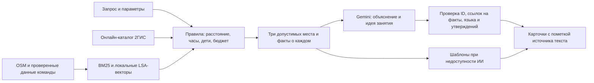

# Серуен — прогулки по Астане

ИИ-помощник по прогулкам в Астане. Скажите, чего хотите, — например, «полтора часа, холодно, с ребёнком», —
и Серуен подберёт 1–3 места рядом: открытые сейчас, укладывающиеся в ваше время вместе с дорогой,
с объяснением «почему», идеей занятия и источниками.

Проект сделан командой из трёх человек для кейса НИЦ Smart City (Build with AI).

- [Сайт](https://seruen-astana.netlify.app)
- [Сценарии, ограничения и этика](docs/scenarios_and_ethics.md)
- [Контракт API](docs/api.md) и [OpenAPI](docs/openapi.json)
- [Данные](docs/data.md)

## Возможности

- Поиск по запросу, времени, составу компании, погоде и расходам («только бесплатно»).
- До трёх мест с «почему», «что делать», временем визита, пешим путём, расписанием и источником.
- Выбор финиша (остаться, вернуться, другая точка), маршрут по улицам, остановки по пути, встреча вдвоём.
- «Планы изменились»: «Замёрзли», «Устали», «Осталось меньше времени» — приложение предлагает замену или остановку рядом; маршрут меняется только после вашего выбора, прежний можно вернуть.
- Места, где согреться, туалеты и скамейки, проверенные командой на месте.
- Личные списки и сохранение плана для офлайна — всё хранится только на устройстве.
- Казахский, русский и английский. Без аккаунтов и игровых механик.

## Как это работает



1. Сборщик получает OSM через Overpass, нормализует и удаляет дубликаты; Wikipedia и сведения команды обогащают снимок. `python -m pipeline.run` пересобирает кешированные исходники; `--fresh` обращается к внешним источникам. Ключи необязательны.
2. Локальный поиск сочетает BM25 и LSA (TF-IDF → SVD, 64 измерения). Это бесплатный корпусный индекс, не Gemini Embeddings. Онлайн-поиск (при наличии ключа 2ГИС) получает до двух страниц 2ГИС за порцию, затем применяет те же ограничения и ранжирование. Если онлайн-поиск недоступен или пуст, используются места из локального снимка с явной пометкой.
3. Из текстового индекса исключены сгенерированные описания и предположенные удобства. Подтверждённые запрошенные Wi-Fi, розетки и тишина повышают приоритет. Для 2ГИС используются только явно опубликованные положительные атрибуты; принадлежность к категории не доказывает удобства.
4. Gemini получает три прошедших фильтры места, факты с идентификаторами, запрос и контекст. Он пишет короткое «почему» и действие на RU/KK/EN и обязан сослаться на существующие факты через `evidence_ids`.
5. Сервер проверяет ID, язык, длину, ссылки на факты и известные неподтверждённые утверждения. Цены, часы, числовые бюджеты и гарантии не берутся из текста модели. Это снижает риск выдумок, но не доказывает истинность любого свободного текста.
6. Ранжирование, финиш и длительности считаются по правилам. Принятый текст модели помечен `why_source=ai`, остальные карточки — `template`. Без ключа всё работает в режиме `no_ai`.

## Расстояния и бюджет

- Пешая оценка карточки: `ceil(haversine × 1.3 / speed)`, скорость 75 м/мин; с ребёнком, зимой или при температуре ≤0 — 60.
- Целевой визит: кофе 20, еда 30, парк 20, дети 25, культура 30, смотровая 15, ТРЦ 20, спорт 25, вечернее место 30, необычное 20, библиотека 30, коворкинг 40 минут. Для короткого бюджета: минимум из цели и `max(10, floor(budget/2))`.
- Общий бюджет: путь туда + посещение + выбранный путь после посещения + резерв. `place` — остаться, `return` — вернуться, `destination` — другая точка.
- Резерв обычно 5 минут, перед вылетом — 60. Запас на аэропорт условный: реальная дорога и регистрация не рассчитаны.
- Поиск начинается рядом; при отсутствии результатов расширяется один раз ×1,5. Ночью радиус ≤1 км, при сильном холоде/ветре ≤500 м; для кофе/работы путь туда ≤15 минут.
- Базовый балл: 0.4 × текстовое сходство + 0.25 × близость + 0.15 × популярность + 0.1 × статус часов + 0.1 × совпадение подтверждённых тегов. Дополнительно до 0.4 за долю подтверждённых запрошенных удобств, 0.15 за помещение в сильный холод.
- Маршруты строятся пешеходным OSRM. При его недоступности возвращается явно помеченная оценка.

## Запуск

Python 3.12+, Node 22+. Из корня репозитория:

```bash
make setup      # виртуальное окружение и зависимости
make index      # поисковый индекс
make run        # API на http://127.0.0.1:8000 (документация — /docs)
```

Сайт — статические файлы без сборки:

```bash
python3 -m http.server 5173 --directory frontend   # http://localhost:5173
```

Адрес API задаётся в `frontend/config.js` (`python scripts/set_api_url.py http://127.0.0.1:8000`).

Ключи необязательны. Без них работает режим `no_ai` на локальном снимке. Чтобы включить Gemini, Google Places и 2ГИС,
скопируйте `.env.example` в `.env` и укажите свои ключи. Файл `.env` не коммитится.

## Проверки

```bash
.venv/bin/python -m pytest -q
npm ci && npm test
POI_PATH=data/poi.json DATA_KIND=real .venv/bin/python eval/run.py --output eval/real
.venv/bin/python eval/run_spec.py
```

Два набора по 30 запросов: [исходные фикстуры](eval/real/report.md) и [сценарии из спецификации](eval/real_spec/report.json).
Автотесты проверяют структуру и ограничения; оценки полезности пользователями не выдумывались.

## Данные и фото

В снимке 1 251 место: 270 записей с часами OSM, 22 описания Wikipedia, остальные описания помечены `generated`.
Неизвестные часы и рейтинги не заполняются догадкой. Подробности: [данные](docs/data.md), [отчёт сборщика](data/quality_report.md),
[данные для функций прогулки](docs/feature_expansion_data.md).

Фото показываются только после проверки конкретного места и совпадения SHA-256 (`data/photo_identity_review.json`).
«Фото пока нет» честнее чужого интерьера. Анализ фото описывает видимое и не доказывает тишину, безопасность или свободные места.
Подробнее — [фото мест](docs/photos.md).

## Приватность

Координаты округляются до трёх знаков (~100 м), что не является анонимизацией. Заметки и сохранённые прогулки остаются на устройстве.
Gemini получает текст запроса и факты кандидатов, без отдельных полей координат пользователя, финиша и истории; личные данные,
введённые в текст вручную, автоматически не удаляются. 2ГИС получает округлённый центр, OSRM — точки пути; внешние поставщики могут
журналировать запросы и IP. Логи приложения содержат только режим, длительность, число кандидатов и код ошибки.
Подробнее: [страница приватности](frontend/about.html).

## Ограничения

Неполные и устаревающие сведения, эвристический разбор языка, приблизительные пешие времена, квоты бесплатных API,
отсутствие гарантии проходимости и безопасности маршрута, отсутствие нагрузочного аудита. Проверки удобств на месте
имеют срок годности: устаревшие записи автоматически перестают использоваться.

## Структура

| Папка | Что внутри |
|---|---|
| `backend/` | API на FastAPI: поиск, правила, генерация, маршруты |
| `frontend/` | сайт (PWA): карта, карточки, офлайн |
| `pipeline/` | сборка снимка мест из OSM и Wikipedia |
| `data/` | снимок мест, индекс, данные функций прогулки |
| `eval/` | сценарии и отчёты проверок |
| `tests/` | автотесты Python и фронтенда |
| `docs/` | API, данные, сценарии и этика; `docs/archive/` — рабочие заметки периода разработки |

## Команда

- Томирис — бэкенд и API
- Алихан — сайт, карта, мобильная версия
- Ерлан — данные, сценарии и проверки на месте

## Лицензия

Код — [MIT](LICENSE).

Данные и фото распространяются на своих условиях:

- Данные OpenStreetMap — © участники OpenStreetMap, [ODbL 1.0](https://opendatacommons.org/licenses/odbl/1-0/).
- Фото Wikimedia Commons — CC0 / CC BY-SA; автор, лицензия и ссылка указаны у каждого фото в
  `frontend/img/places/index.json` и `frontend/img/credits.json`.
- Собственные фото команды (`team-*`) — © команда Серуен.
- Описания из Wikipedia — CC BY-SA, со ссылкой на статью.
